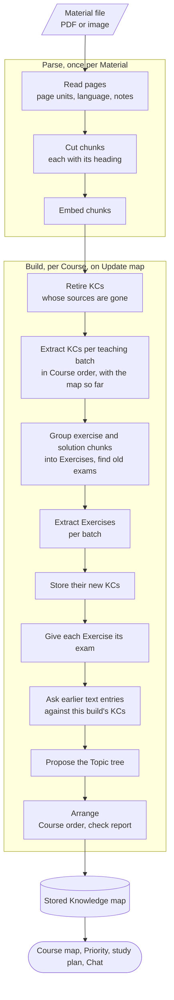
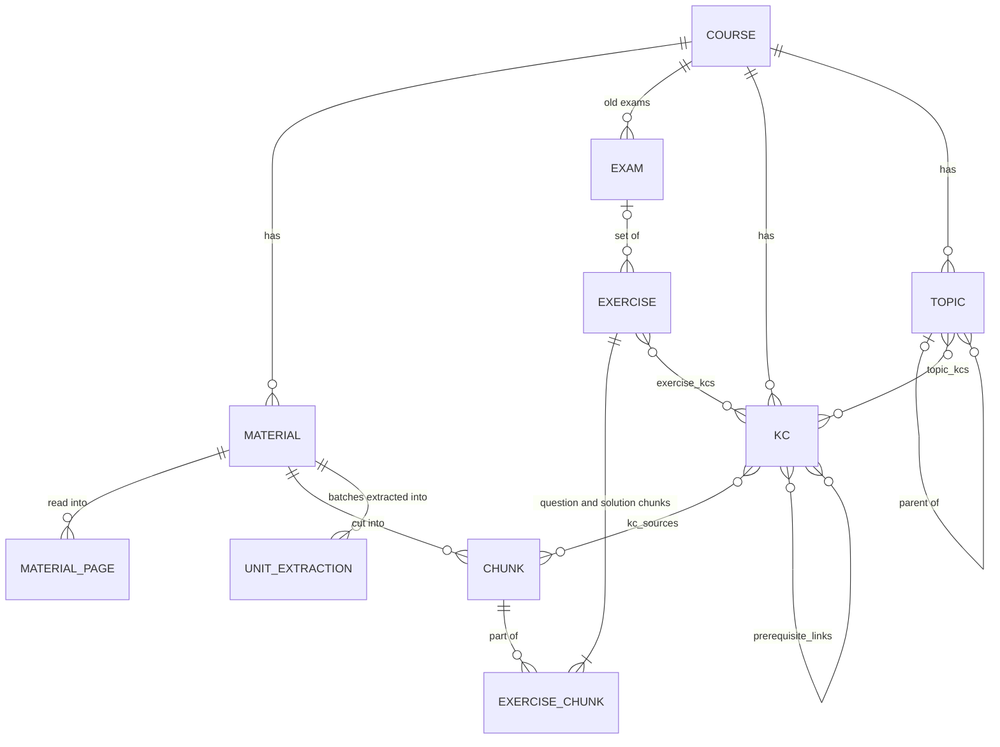

# The Knowledge map

How a Course's Materials become its Knowledge map: what data exists, how it flows, which model calls make it, and how their prompts get built.

The Knowledge map is half of one system. This document covers everything up to and including the stored map. [The tutoring process](tutoring.md) starts from the stored map and covers everything a Student does with it. [How the two connect](#how-the-two-connect) lists every point where they touch.

Domain words are defined in [GLOSSARY.md](../../GLOSSARY.md); the choices behind the design are in [ADR 0007](../adr/0007-ingest-each-upload-once.md), [0020](../adr/0020-topics.md), [0021](../adr/0021-problem-verification.md), [0023](../adr/0023-knowledge-map-from-chapters.md), [0026](../adr/0026-assumptions-as-text.md) and [0033](../adr/0033-topics-from-kcs-and-parse-without-outline.md).

## What the map is for

The map gives the AI tutor five things, and nothing else:

1. **Topics**: a big picture of everything in the Materials.
2. **Chunks**: every Material searchable.
3. **KCs**: what the Student's mastery is tracked on, so nothing is forgotten.
4. **Prerequisites**: an order that makes sense to teach in.
5. **Exercises and old exams**: real practice, and Priority when they are good.

Keep only what these need: every other structure in the pipeline is internal and stays thin. The map is never perfect, and it must never stand in the tutor's way.

**Any material.** The pipeline serves every kind of school, college and university material: scripts, slides, exercise sheets, solutions, old exams, scans, books. Solve a problem with a rule that holds for any material, never with one that names a layout, a type of material or a course: such rules fit the Materials at hand and fail on the next upload. Accept an imperfect map for unusual material over a special case.

## The short version

Two background jobs run one after the other:

1. **The parse** turns one uploaded Material into text: chunks of Markdown, each with the heading it follows, and the Material's language and notation. It runs once per upload, by itself.
2. **The build** turns all of a Course's chunks into the map: Knowledge components (KCs), the Prerequisites between them, Exercises and a Topic tree. It runs when the Student presses Build, then Update map.



Every step stores its result before it ends, so a stopped job resumes where it stopped and pays for no model call twice.

## The data



| What                  | Table                  | What it holds                                                                                                                                                                                                                               | Written by                                    |
| --------------------- | ---------------------- | ------------------------------------------------------------------------------------------------------------------------------------------------------------------------------------------------------------------------------------------- | --------------------------------------------- |
| Material              | `materials`            | The file's name, place in Storage and Course order (`position`), parse progress, and the `language` and `notes` (at most 1,000 characters) the page read found                                                                              | Upload, then the parse                        |
| Page result           | `material_pages`       | One row per page: the **page units** that start on it, or why it was `skipped` (`overlay`, `blank`, `unreadable`, `uncovered`, `titles`). A working table for the parse                                                                     | Parse                                         |
| Chunk                 | `chunks`               | A passage of Markdown with its pages, the `heading` it follows (null before the Material's first), vector and `label`: `content`, `exercise`, `solution` or `admin`                                                                         | Parse                                         |
| Exercise chunk        | `exercise_chunks`      | Each question and solution chunk of an Exercise, with its `role` and order. A chunk belongs to at most one Exercise                                                                                                                         | Build (grouping)                              |
| Old exam              | `exams`                | An exam the grouping call found, named as printed, with `position`, the Student's answer `confirmed` (null, true or false) and `asked` (the Brief asked about it)                                                                           | Build. The Brief sets `confirmed` and `asked` |
| Unit extraction       | `unit_extractions`     | The checked answer of one extraction call, keyed by Material, kind and batch, with the unit's content hash, `kc_ids` once stored and `assumes_matched` once its text is on its KCs                                                          | Build                                         |
| Knowledge component   | `kcs`                  | Name, description, vector, Course order (`position`), `origin` (`content` or `exercise`), `assumes` (what it assumes that no KC means, as text) and `retired_at` when it left the map                                                       | Build                                         |
| KC source             | `kc_sources`           | Which chunks teach a KC. Every live KC has one: a KC whose sources are all gone is retired                                                                                                                                                  | Build                                         |
| Prerequisite          | `prerequisite_links`   | `from_kc` must be learned before `to_kc`. They form no cycle                                                                                                                                                                                | Build                                         |
| Exercise              | `exercises`            | Keyed by its first question chunk; its other chunks are in `exercise_chunks`. `exam_id` is the old exam it belongs to, if any. Difficulty 1 to 3 and `final_answers` as printed: answer keys `{ label, value, anyOrder }`, values in mathjs | Build                                         |
| KCs an Exercise tests | `exercise_kcs`         | At most 6 per Exercise                                                                                                                                                                                                                      | Build                                         |
| Topic                 | `topics`               | Name, parent, tree order, `central_question`                                                                                                                                                                                                | Build                                         |
| A Topic's own KCs     | `topic_kcs`            | Each KC in one Topic, in teaching order                                                                                                                                                                                                     | Build                                         |
| Build state           | `knowledge_map_builds` | One row per Course: status, failure reason, heartbeat, `check_report`, `topic_tree_hash`, `exercise_grouping_hash`, the grouping's `exercise_groups`, and `needs_update`                                                                    | Build                                         |

**"Unit" means two things**, one in each job. A _page unit_ is a run of one label under one heading, as a page read returns it. A _teaching batch_ is the run of a Material's `content` chunks one extraction call reads. They never meet: page units become chunks, and chunks are packed into batches. (Stored extractions and code say "unit" for a batch.)

**Stored or derived.** These are not stored, and are computed from the tables above on every read:

| Derived                  | From                                                                             | Code                                           |
| ------------------------ | -------------------------------------------------------------------------------- | ---------------------------------------------- |
| A Topic's anchors        | Prerequisites of its KCs that come from outside it                               | `topicAnchors` in `domain/topic-reading.ts`    |
| Reading sections         | The `content` chunks its KCs cite, cut to at most 3 pages in one Material        | `readingSections` in `domain/topic-reading.ts` |
| An Exercise's label      | Where its question is printed, as "heading · Material p. N"                      | `domain/exercise-label.ts`                     |
| Arrows on the Course map | Prerequisites between KCs of different Topics, transitively reduced              | `domain/topic-graph.ts`                        |
| Priority                 | The map and the Brief ([tutoring](tutoring.md#everything-derived-on-every-read)) | `priorities/domain/priority.ts`                |

Paths in this document are relative to `src/features/knowledge-map/` unless they name another feature.

## Step by step: the parse

The `parseMaterial` workflow in `ingestion/workflows/parse-material.ts` starts when a Material is registered. It moves the Material from `queued` through `parsing` to `parsed` or `failed`.

1. **Prepare pages.** Opens the PDF, records the page count and stores slide overlays (pages whose text the next page repeats) as `skipped`, without a call. An image is one page.
2. **Read pages.** Up to 20 pages per workflow step, 5 per call. A blank page needs no call. Each batch sends the Material's name, the last unit before the batch as context, and each page's image and text layer, and gets back ordered page units plus the pages' language and any unusual notation (`notes`). Each unit is stored on the page it starts on, with the page's answer about language and notes. A batch that fails for good is read again page by page, and a page that still fails is stored `unreadable`, so one bad page doesn't stop the parse. Every page of an answer has units or a skip reason: a page with nothing to learn or practise (decoration, a picture without information, a repeated course header, a title page, contents, an index) is listed under the one skip reason `nothing_to_learn`, not transcribed, stored `titles`, not read again and not counted as unread. A page of an answered batch with neither (by its pages) is read again alone once, and stored `uncovered` when still none does.
3. **Language and notes.** Pure code (`materialLanguageAndNotes`). `materials.language` is the language most pages named; `materials.notes` joins the distinct notes, cut to 1,000 characters. There is no call for the Material's structure.
4. **Cut chunks.** Pure code (`chunksFromUnits`). Each page unit becomes a chunk. A unit cut off at a batch edge joins its continuation. Each heading unit starts the next chunk as a bold line and becomes its `heading`; a chunk with no heading of its own keeps the previous chunk's heading, and one before the Material's first heading has none. A chunk over 6,000 characters splits between paragraphs. Chunks are written in one transaction (`replace_material_chunks`).
5. **Embed.** Every chunk except `admin` ones, 20 per call, as documents.
   The parse makes no exercise call: which chunks form an Exercise is decided in the build, across the whole Course, so upload order doesn't matter.

The chunk labels decide where each chunk goes next:

| Label      | Used by                                                                                |
| ---------- | -------------------------------------------------------------------------------------- |
| `content`  | Teaching units of the build. Searchable by the AI                                      |
| `exercise` | Exercise units of the build. Searchable                                                |
| `solution` | Reaches the build through the grouping, as a solution chunk of an Exercise. Searchable |
| `admin`    | Never embedded. The Brief reads it to propose exam scopes (`loadAdminChunks`)          |

## Step by step: the build

The `buildKnowledgeMap` workflow in `workflows/build-knowledge-map.ts` passes only the Course's id. Each step reads what it needs from tables, does a bounded amount of work and reports how much is left, and the workflow calls it again until nothing is.

The Student's button calls `startKnowledgeMapBuild`, which queues through `queue_knowledge_map_build`. It lets a build through only when none runs, a Material is parsed and none waits or parses, so two presses start one build.

### 0. Prepare

`prepareBuild` fails the build with a reason when the Course has no `content` or `exercise` chunks, and retires KCs whose sources are gone.

### 1. Extract the teaching units

`extractTeachingBatches` makes one call per teaching batch without a current extraction, **one after another in Course order**: Materials by position, batches in reading order. Each call is offered `knownKcs`: every live KC stored so far, in Course order, with a short id (`k1…`), the heading its first source follows (an exercise KC: its anchor KC's heading), its name and description. A batch's answer is stored, and then stored as KCs, before the next unit's call, so the next unit sees them.

A **teaching batch** comes from `teachingBatches` in `domain/teaching-batches.ts`: a Material's `content` chunks in reading order, packed up to 12,000 characters (`UNIT_CHARS`, about 15 KCs). A batch that is at least half full ends before a chunk that starts under a new heading, so a subject is cut where a heading would do; a chunk over the cap is a batch of its own. A KC of a batch may cite any chunk of the batch; the check report's uncited pages and the map smoke check follow that rule. Batches are recomputed on every build, so a changed batch has a new hash and is extracted again. Exercise batches are formed by `exerciseBatches` (step 3). Extractions are keyed by Material, kind (`content` or `exercise`) and batch number (`unitKey`, table `unit_extractions`).

An old exam is no flag: its text is ordinary content and its tasks are ordinary Exercises. A batch the build no longer forms loses its extraction when the next step loads the current ones.

A unit's hash covers its chunks' Markdown (`unitHash`), not `knownKcs`. A unit whose stored extraction has the same hash makes no call: this is why Update map is cheap.

The call answers:

- `repeats`: known KCs this unit teaches again, each with the chunks that teach it here. They become sources of that KC; no KC is stored for them. This is how slides next to a script add sources instead of duplicates.
- New KCs, each with an id for the call (`n1…`), name, description, the chunks that teach it, its `prerequisites` as ids (known KCs, from anywhere earlier in the Course, or new KCs before it in the unit) and `outside`: up to 3 things it uses that no listed KC teaches, which become text in `kcs.assumes`.

Its prompt sizes a KC as what a Student masters as a whole (`KC_DEFINITION` in `ai/kc-definition.ts`, shared with the exercise prompt's line for new KCs): a method with its variants, special cases and inverse, a concept with its properties, a result with its use; two KCs only when a Student could master one and still fail the other; a slide, page or section is never the unit of size; motivation, previews and findings told to illustrate a point belong to the KC they serve or to none. Besides: headings, summaries, notation lists, repeated material and asides beyond the course are no KCs, an example, counterexample or remark belongs to the KC it serves, and the headings only show where a chunk sits (KCs come from the chunks' text). This is guidance in the prompt; code caps no KC count. Changing it needs a migration that deletes the stored extractions, since the batch hashes do not cover the prompt. A Prerequisite is a KC this one uses directly: a notion its statement is written with, a result its proof cites, a method its method runs. `checkExtraction` turns short ids into stored references and drops ids it does not know. **Coverage** (`unitCoverage` in `domain/unit-coverage.ts`) is the share of the unit's characters in chunks some KC cites: below `MIN_UNIT_COVERAGE` (0.5) the call is made once more, and the answer that covers more is kept. An answer with no KCs (a notation list, say) is kept as it is, without that retry; the check report lists its pages under pages no KC cites. The result goes into `unit_extractions`, and is then stored as KCs (step 2).

A unit whose call failed, or that the rate limit turned away, is called again after the others.

### 2. Store the KCs

`storePendingExtractions` in `workflows/consolidate-steps.ts` turns stored extractions into stored KCs without a model call. The extraction step runs it after each complete unit; `consolidateKcs` runs it as a step for a unit given up on and for the exercise units. For each extraction:

1. **Embed** each new KC as "name: description".
2. **Revive:** a retired KC at cosine similarity 0.90 or more comes back instead of a new one.
3. **Store** with `store_unit_kcs` in one transaction: new KCs with their sources, repeats as sources of their KCs, and the Prerequisites inside the unit and from known KCs. They go through `acyclicLinks`, where a link that would close a cycle is dropped, so each cycle loses its newest link.
4. **Write `outside`** as text on its KC with `store_assumed_prerequisites`, which marks the extraction `assumes_matched`. A step that stopped between 3 and 4 writes it on the next run.

A partial extraction (a unit in pieces) waits until the unit is complete or given up, so its KCs are stored once. When a unit given up on is tried whole on a later Update map, the KCs its pieces stored come back as repeats.

### 3. Group the chunks, extract the Exercises

**Grouping.** `groupExercises` (`workflows/group-steps.ts`) makes one call (task `ingest`, reasoning high) that sees every exercise and solution chunk of the Course in Course order (Material, heading, first 600 characters) and the stored exams. It answers the Exercises, each as question chunk ids and solution chunk ids, with the name of the old exam it belongs to or none, and the exams, each naming the stored one it `continues`. So a stem shared by subtasks, solutions printed between subtasks, and solutions in another Material or on other pages all end up in one Exercise, and an exam is found in a separate file, several in one file or at the end of a script. A Course over 400 chunks (`MAX_GROUPING_CHUNKS`) goes in runs.

Code checks the answer (`domain/exercise-groups.ts`). Unknown ids are dropped. A chunk belongs to at most one Exercise: the first wins. An exercise chunk the answer left out becomes an Exercise of its own, so nothing is lost. An exam name that is not listed means no exam. The call runs only when the Course's exercise and solution chunks changed since the last grouping (`exercise_grouping_hash`), and the answer is stored on the build row (`exercise_groups`). A failed call is tried again in the next step; after that every exercise chunk becomes an Exercise of its own without a solution, and the check report says so. A run that fell back keeps the stored exams.

**Extraction.** `extractExercises` packs the Exercises in Course order into batches of up to `UNIT_CHARS` of statements and solutions (`exerciseBatches`) and makes one call per batch that has no current extraction, **one after another in Course order**. A batch's hash covers its chunks. The call sees each Exercise's whole statement and all its solutions, and **every live KC** in Course order (short id, the heading its first source follows or its anchor KC's, name, description), not a shortlist. A batch's answer is stored as KCs and Exercises before the next batch's call, so the KCs one proposed are listed for the next. That's why it runs after step 2.

It answers, per Exercise: the listed KCs its solution uses as a step (usually 1 to 4, at most 6), new KCs only when no listed one teaches what it needs, mathematical final results copied as printed and written as mathjs (code drops a key mathjs cannot parse; the prompt leaves out a result that depends on the Student's own choice, such as a representative, an order, a parametrisation or an example), and whether it is no exercise at all. Code then computes the difficulty from the number of KCs and the solution's length (`exerciseDifficulty`).

**One group gives one Exercise**, so "Ex. 7.2" with a shared stem and parts a to c is one Exercise with every part's solution. A new KC's source is the Exercise's first question chunk, with `origin` `exercise`.

### 4. Store their KCs, give each Exercise its exam

Step 2 over the exercise extractions, which also stores their Exercises, keyed by their first question chunk so each keeps its id, and their chunks (`exercise_chunks`). An Exercise marked `notAnExercise` is deleted. `assignExams` then stores the exams the grouping found (`exams`, named as printed) and gives each Exercise its `exam_id` (`set_exercise_exams`). Exams are linked in this separate step because the Exercises exist only after the extraction.

The Brief asks once about each exam found, by name. A confirmed exam's Exercises count for Priority and Mock exams; a rejected exam's are ordinary Exercises. Priority, Mock exams and the Reserved exam read `exams` and `exercises.exam_id` when read, so an answer changes no map and does not mark it for update.

### 5. Ask earlier text against the new KCs

On an update that stored new KCs (created since the build started), `recheckAssumes` asks the text entries of KCs from earlier builds once against them: one call per 50 entries, each call offered every new KC (`k1…`, with heading, name and description). `kcs.assumes` holds each name once.

| The call answers                      | Result                                                                                       |
| ------------------------------------- | -------------------------------------------------------------------------------------------- |
| A KC that comes earlier in the Course | The entry leaves the text and becomes a Prerequisite                                         |
| A KC that comes later                 | The entry leaves the text: a forward link could make the cycle check drop real Prerequisites |
| Null, or the call failed              | The entry stays as text                                                                      |

It handles 100 entries per step, in key order, and the workflow passes the last key it handled to the next run.

### 6. Propose the Topic tree

`proposeTopicTree` makes one call (task `topic`, reasoning high) for the whole Course, and only when its KCs or the language changed: the tree hash (`topic_tree_hash`) covers the live KCs' ids and names and the Course language.

The call sees every live KC in Course order (short id `k1…`, name, the Material and heading of its first source, so KCs from exercises are included), the Course language and the stored Topics (`t1…`) with their level and KC ids. It answers a flat list in tree order, where `level` (1 or 2) gives the nesting: a level-2 Topic is a child of the nearest level-1 Topic before it. Each Topic has a name, the KCs it holds itself, its central question and which stored Topic it `continues`. The prompt asks for Topics that are each one subject learned as a block, usually a few to about ten KCs, joining what several Materials teach, never a Topic of a single KC where a neighbour fits, never one named after a single slide or page; a level-1 Topic with children only groups them. Topic size is guidance in the prompt, not a limit in code.

### 7. Arrange

`arrangeKnowledgeMap` makes no model call. It:

- retires KCs whose sources went meanwhile;
- orders the KCs by first source (an exercise KC sits right after the earliest other KC its Exercises test, so it shows that KC's heading);
- turns the proposal into Topics (`planTopicTree`, rules below), with each Topic's KCs in teaching order (Prerequisites first);
- drops redundant Prerequisites (transitive reduction);
- stores the check report: Material pages with content that no KC cites (`uncitedPages`), Exercises without KCs, KC pairs still alike, teaching batches below the coverage bar, pages read without units (`unreadable` or `uncovered`) and batches given up on (`unitsNotExtracted`). The Course map shows the Student one line when pages went unread or places were covered only in part, such as "Slides p. 3–7", which includes batches given up on (`checkReportLine`), and the full lists outside production;
- marks the build `built`.

`planTopicTree` gives the model's proposal the guarantees the tutoring relies on:

- Levels below 2 become 2: the tree has at most two levels.
- Each KC, from a teaching batch or an exercise call alike, goes to the first Topic that names it. A KC no Topic names goes to the Topic of the KC before it in Course order, or after it for the first KC. When no Topic names any KC, each Material's KCs make a Topic named by the Material.
- A Topic left with no KCs and no children is dropped.
- **Continuity.** A Topic keeps the stored id it `continues` when that id is stored and no earlier Topic took it. A stored Topic that no Topic continues is then continued by the free Topic sharing most KCs with it, when that Topic continues no other, so a tree call that forgets a Topic does not lose its exam scopes, Topic choices and notes. A stored Topic with no KC in common with a free Topic goes.
- A Topic with KCs of its own always has a central question, its name if the call gave none. A Topic with only child Topics has none, and the study plan skips it.

### One batch through the build

An illustration with made-up content:

```text
Teaching batch "Script p. 20–23", three content chunks under "4.2 Subspaces"
  │ extract
  ▼ unit_extractions.output
  offered knownKcs: [{ id: "k7", heading: "3.1 Vector spaces", name: "Vector space axioms", ... }, ...]
  kcs: [{ id: "n1", name: "Subspace criterion", description: "A subset is a subspace when ...",
          chunkIds: [<chunk 2>], prerequisites: ["k7"],
          outside: [{ name: "Set notation", ... }] }, ...]
  │ store: "Subspace criterion" revives no retired KC
  ▼ kcs + kc_sources + prerequisite_links
  a new KC with one source chunk, a Prerequisite from the KC taught under 3.1,
  and "Set notation" in its assumes
  │ exercises: "Ex. 4.3a" tests it, final answer "dim W = 3"
  ▼ exercises + exercise_kcs
  │ Topic tree: the KC goes to the Topic "Subspaces", beside KCs from the slides
  ▼ topics + topic_kcs
  Topic "Subspaces": "Subspace criterion", ...
  Its anchors, the KC taught under 3.1, and its Reading sections are computed on read.
```

## How the prompts get built

All seven calls follow one pattern, so the prompts stay small and the answers checkable:

- **The instructions are a static string** in the feature's `ai/` folder. Nothing about the Course goes in them.
- **The user message is the input as JSON** (or, for a page read, images and text). All Course data goes here.
- **The model sees short ids**, such as `c1`, `k1` or `h3`, never database ids. Code maps each back and drops any it doesn't know.
- **A wrong id doesn't fail the call** (`offeredId` in `ai/offered-id.ts`). The JSON schema lists the ids as an enum to guide the model, but any string validates, so the check in code decides what to keep.
- **The answer is structured**, through `Output.object` with a Zod schema, whose `.describe()` texts are part of the prompt.
- **Calls fit a Vercel function.** A build call ends after `BUILD_CALL_TIMEOUT_MS` (260 s), and a step starts no call that could run past 290 s (`callFits` in `src/lib/ai/call-timeout.ts`), so each step makes one round of at most `AI_CONCURRENCY` calls. A retry within a step (the coverage retry, the second tree call) gets what is left of the step, when that is at least 60 s (`retryTimeoutMs`). The parse's calls keep `CALL_TIMEOUT_MS` (170 s). With `AI_RPM` set, the parse and build calls start 60 / `AI_RPM` seconds apart (`paceCall`, `src/lib/ai/pacing.ts`, per server instance, so a step's first call on another instance starts at once; the wait comes off a build call's time limit, so its calls still end by 290 s); the wait after a rate limit stays for a limit met anyway. A timed-out call is a failed answer: its usage is recorded as estimated and its trace marked as an error.
- **A failed unit waits a step, then splits.** A unit whose build call times out or gives no valid answer (`buildCall` answers "failed") is left to the next step; the workflow passes the key of a unit once per failure. An extraction unit (teaching or exercise) that failed goes after the others; from its second failure it is called in pieces, each attempt halving every piece again by characters, between chunks (`domain/unit-pieces.ts`). Answered pieces are stored as a partial extraction (its `content_hash` is `partialHash` of the unit's, and `readChunkIds` names what they read), so only failed pieces are called again, and the unit is stored whole once every piece is answered. Once its split into single chunks failed twice, the unit is given up: its partial extraction is stored as KCs, and the check report lists it. A check call that fails leaves its names as text (step 5). The tree call is made twice; when both fail, the stored tree stays and the KCs it lacks follow their neighbours (`planTopicTree`), and the next Update map calls again.
- **A rate limit is a wait, not a failure.** Build calls send no SDK retries (`maxRetries: 0`). A call the Gateway's per-minute rate limit turns away (`buildCall` answers `RateLimited`) starts no further call in its step; the extraction, exercise and check steps store every unit answered so far and leave the rest pending, without counting it failed or splitting it. A teaching unit turned away goes after the others. The step's outcome carries the wait the error names, at least `MIN_RATE_LIMIT_WAIT_MS` (60 s), and the workflow sleeps that long before the next step calls the pending units. The tree call, the only call of its step, retries the step after the wait.
- **Every call is metered** (`meteredStream`), so it counts against the Student's Daily limit and stops the job there.

| Call (trace name)               | Job and task      | Reasoning | User message                                                                                                       | Answer                                                                                                                | Prompt in                    |
| ------------------------------- | ----------------- | --------- | ------------------------------------------------------------------------------------------------------------------ | --------------------------------------------------------------------------------------------------------------------- | ---------------------------- |
| Page read                       | Parse, `ingest`   | none      | Material name, last unit before the batch, then per page: number, image, text layer                                | Units: Markdown, label, pages, heading style, continuation flags; language, notes; skipped pages (`nothing_to_learn`) | `ingestion/ai/page-units.ts` |
| Grouping                        | Build, `ingest`   | high      | Exercise chunks (`e1…`), solution chunks (`s1…`) and stored exams (`x1…`): Material, heading, first 600 characters | Exercises (question and solution chunk ids, exam name or none), exams (`continues`)                                   | `ai/exercise-grouping.ts`    |
| Extraction (`extract-chapter`)  | Build, `map`      | medium    | Material name, Course language, chunks (`c1…`) with their heading, `knownKcs` (`k1…`): heading, name, description  | `repeats`; new KCs (`n1…`) with `chunkIds`, Prerequisites by id, `outside`                                            | `ai/chapter-extraction.ts`   |
| Exercises (`extract-exercises`) | Build, `exercise` | medium    | Material name, Course language, Exercises (`s1…`) with whole statement and all solutions, every KC (`k1…`)         | Per Exercise: KCs, new KCs, final answers, `notAnExercise`                                                            | `ai/exercise-extraction.ts`  |
| Check (`check-prerequisites`)   | Build, `map`      | medium    | Names (`n1…`): name, description, the KC using it; the KCs this build stored (`k1…`)                               | For each name, the KC it means or null                                                                                | `ai/prerequisite-check.ts`   |
| Tree (`topic-tree`)             | Build, `topic`    | high      | Course language, every live KC (`k1…`): name, Material, heading; stored Topics (`t1…`) with their KCs              | Flat Topic list: level, name, `kcIds`, central question, `continues`                                                  | `ai/topic-tree.ts`           |

The vectors come from task `embed`: chunks as their Markdown, KCs as "name: description". Which model serves each task is set in `src/lib/ai/models.ts`.

**Course language.** KC names, descriptions and Topics are written in the language from `loadCourseLanguage`: the Student's choice in the Brief, otherwise the most common language of the Materials, otherwise English. The Materials themselves are transcribed untranslated.

## Updates and identity

A build always _updates_ the stored map. The tutoring keys everything on KC, Exercise and Topic ids, so those survive updates wherever the content does.

| Thing           | Keeps its id because                                                                       | Loses it when                                                               |
| --------------- | ------------------------------------------------------------------------------------------ | --------------------------------------------------------------------------- |
| KC              | A unit names it as a repeat, or a new KC revives it, instead of a KC being stored as new   | Never deleted: it is only retired, and it keeps its Attempts                |
| Exercise        | It is stored by its first question chunk                                                   | Its question chunk is deleted                                               |
| Topic           | The tree call names it under `continues`, or code continues it by the KCs it shares        | No new Topic holds a KC of it, which also loses its notes and Topic choices |
| Reading section | Its id is a UUID v5 of Topic, Material and pages, so a Done mark holds while the cut stays | The cut changes                                                             |

What happens to the map when the Student changes the Materials and presses Update map:

- **A Material is added.** Its units are new, so they are extracted. Other units keep their hash and make no call. Its units are offered the stored KCs: what they teach again adds sources to them, and their new KCs link to them. Text that KCs of earlier builds assume is asked once against its new KCs. The tree call runs again because the KCs changed.
- **A Material is deleted.** Its chunks go, and with them their `kc_sources` and the Exercises they pose. The next build groups the remaining chunks again (the hash changed) and retires each KC with no sources left.
- **An old exam is confirmed or rejected.** Nothing is rebuilt: Priority, Mock exams and the Reserved exam read the answer when read.
- **Nothing changed.** No model calls: every hash matches, and the stored tree is arranged again.

A parse never changes a Material's chunks once it has stored them, so a unit's hash only changes when its chunks go.

## When things go wrong

| Situation                  | What happens                                                                                                                                                           |
| -------------------------- | ---------------------------------------------------------------------------------------------------------------------------------------------------------------------- |
| A step fails after retries | The build is `failed` with a plain reason. What is stored stays, and the next Update map resumes                                                                       |
| The Daily limit is reached | The same, with the reason "Daily limit reached"                                                                                                                        |
| The process dies           | Each step sets `heartbeat_at`. After 30 minutes without one, the page shows the build as failed and `queue_knowledge_map_build` lets a new one through                 |
| A step would run too long  | A step takes at most 8 units, each build call ends after 260 seconds, and a step starts no call that could end after 290 seconds. What it leaves goes to the next step |
| A unit keeps failing       | It is called in ever smaller pieces, and given up with what its pieces gave; the check report lists it, and the next Update map tries it whole again                   |
| A model call answers badly | Code drops unknown ids and unusable items. The check report shows what ended up uncovered                                                                              |
| The parse fails            | The Material is `failed`, and Retry resumes at the first page without a result. Chunks already stored are kept with their vectors                                      |

## The Course map

The Course map (`/courses/[courseId]/map`, where the Course's home redirects) polls while a build is `building`. It draws the Topics as nested boxes of Topic cards with arrows between Topics ([ADR 0017](../adr/0017-react-flow-and-elk-for-the-knowledge-map-graph.md)): `domain/` computes the graph, and ELK lays it out in a web worker only when it changes.

A card opens the Topic page (`map/[topicId]`): its detail, anchors, KCs, Reading sections and neighbours in Course order, above a KC graph of the Topic's KCs, its anchors and the Exercises that test them. Clicking a KC opens a panel with every stat about it.

**Developer view.** Outside production, a developer account (a `developers` row) sees a Developer link that opens `/dev/courses/[courseId]`: the Course's Materials as page grids, chunks with their headings, teaching and exercise batches with coverage, KCs, Exercises, Topics and the build's state, linked to each other, with suspect spots flagged ([ADR 0031](../adr/0031-developer-view-outside-production.md)). It reads everything from one `course_build_snapshot` call. Every parse and build call carries trace metadata `courseId`, plus `materialId` (parse calls) or `unitKey` (Material, kind and batch; `extract-chapter`, `extract-exercises`); the view lists the Course's calls from Langfuse in Build, links each batch to its calls, flags failed and retried ones, and loads a call's input and output on click.

**What changes the map.** A Material that finished parsing or was deleted sets `knowledge_map_builds.needs_update` (database triggers, `mark_map_needs_update`). While it is set and no build runs, the Course map shows "Your Materials changed since the map was last built." with Update map. `prepareBuild` clears it before the build reads the Course, so a change during a build marks the map again.

## How the two connect

The map is the tutoring's only source of what there is to learn. The tutoring reads it through `knowledge-map/server.ts` and never writes to it.

| The tutoring needs                              | It reads                                                   | Used for                                                                                                                   |
| ----------------------------------------------- | ---------------------------------------------------------- | -------------------------------------------------------------------------------------------------------------------------- |
| KCs, Prerequisites, Exercises, sources          | `loadStoredMap`: live KCs only, and links between live KCs | Every Attempt and FSRS card is per KC. Priority, due reviews and `getTopic`                                                |
| Topics with KCs of their own, in teaching order | `loadStoredTopics`                                         | The plan scope, the Ranking and the Today card                                                                             |
| The whole Topic tree                            | `loadTopicTree`                                            | Exam scopes inherited down the tree, the Course map                                                                        |
| Anchors                                         | `topicAnchors`                                             | `getTopic`: what a Topic builds on                                                                                         |
| Reading sections                                | `loadReadingSections`                                      | `getTopic` and the `showReading` tool                                                                                      |
| Chunks, through `ingestion/server.ts`           | `loadChunkSources`, `match_chunks`                         | `getTopic` sources and `searchMaterials`: what the AI cites                                                                |
| Exercises with `final_answers`                  | `loadStoredMap`                                            | `findProblems`, the answer check in `grade`, variants, Mock exams                                                          |
| What each KC assumes (`kcs.assumes`)            | `loadKcAssumes`                                            | The tutor context's proposed Topic and `getTopic`: texts the AI checks and teaches briefly, marked as beyond the Materials |
| `materials.notes`                               | `loadMaterialNotes` in `study`                             | The tutor context gives the AI each Material's notation                                                                    |

**Rebuilding while a Student studies.** Tutoring reads the map fresh on every reply, so an update takes effect on the next one. Attempts stay valid because KC ids hold.

**Dependency direction.** `study` and `priorities` import `knowledge-map`. `knowledge-map` never imports either, so the Course map's pages pass each Topic's learned count and Readiness, Priorities and KC learning (recall bands) in as props.

## Where the code is

| To change                            | Look in                                                                                                                                                                                            |
| ------------------------------------ | -------------------------------------------------------------------------------------------------------------------------------------------------------------------------------------------------- |
| What a model is asked                | `ai/*.ts`, `ingestion/ai/*.ts`                                                                                                                                                                     |
| How an answer is checked             | `domain/chapter-extraction.ts`, `domain/exercise-extraction.ts`, `domain/exercise-groups.ts`, `domain/topic-tree.ts`, `ingestion/domain/chunk-joining.ts`, `ingestion/domain/material-language.ts` |
| Order and bounds of the steps        | `workflows/build-knowledge-map.ts`, `workflows/*-steps.ts`, `ingestion/workflows/parse-material.ts`                                                                                                |
| Limits                               | `UNIT_CHARS`, `UNITS_PER_STEP`, `CALL_TIMEOUT_MS`, `MIN_UNIT_COVERAGE`, `NAMES_PER_CALL`, `PAGES_PER_BATCH`, `MAX_GROUPING_CHUNKS`, `MAX_CHUNK_CHARS`, each in the file that uses it               |
| Thresholds for alike and revived KCs | `SAME_KC_SIMILARITY`, `REVIVE_SIMILARITY` in `domain/kc-clusters.ts`                                                                                                                               |
| Tree rules                           | `domain/topic-tree.ts`                                                                                                                                                                             |
| Anchors and Reading sections         | `domain/topic-reading.ts`                                                                                                                                                                          |
| What is written in one transaction   | The `store_*`, `arrange_*` and `replace_*` functions in `supabase/migrations/`, newest definition                                                                                                  |

To see it run: `pnpm smoke parse`, `pnpm smoke pair` (the grouping check) and `pnpm smoke map` call real models, so read [docs/agents/live-ai.md](../agents/live-ai.md) first. `pnpm gold` loads the [gold course](../../evals/gold/README.md)'s stored output instead of running the pipeline.

Change this document in the same PR as the behaviour it describes.
